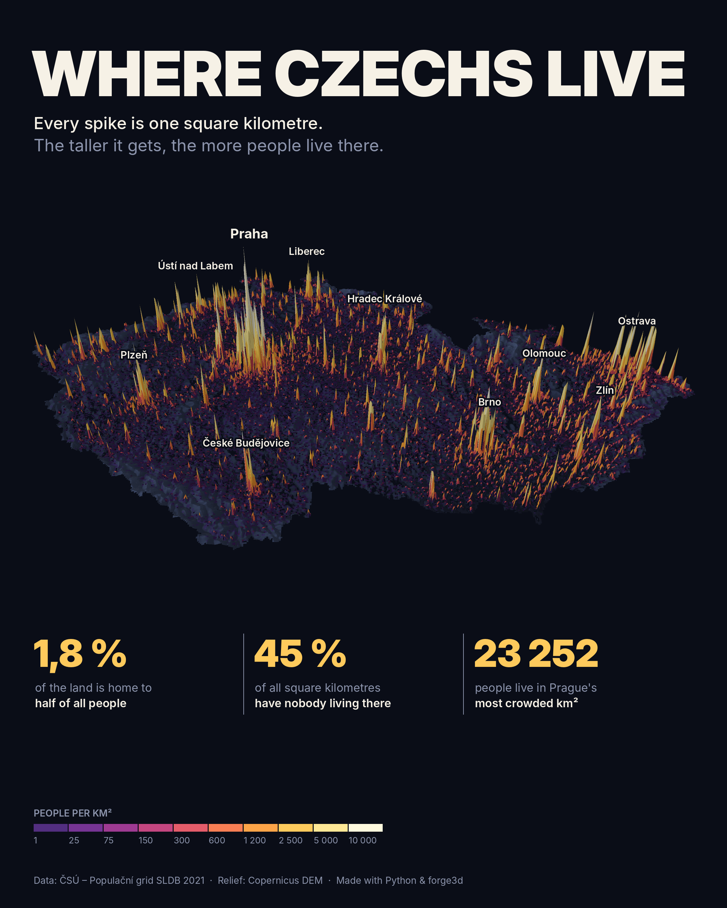
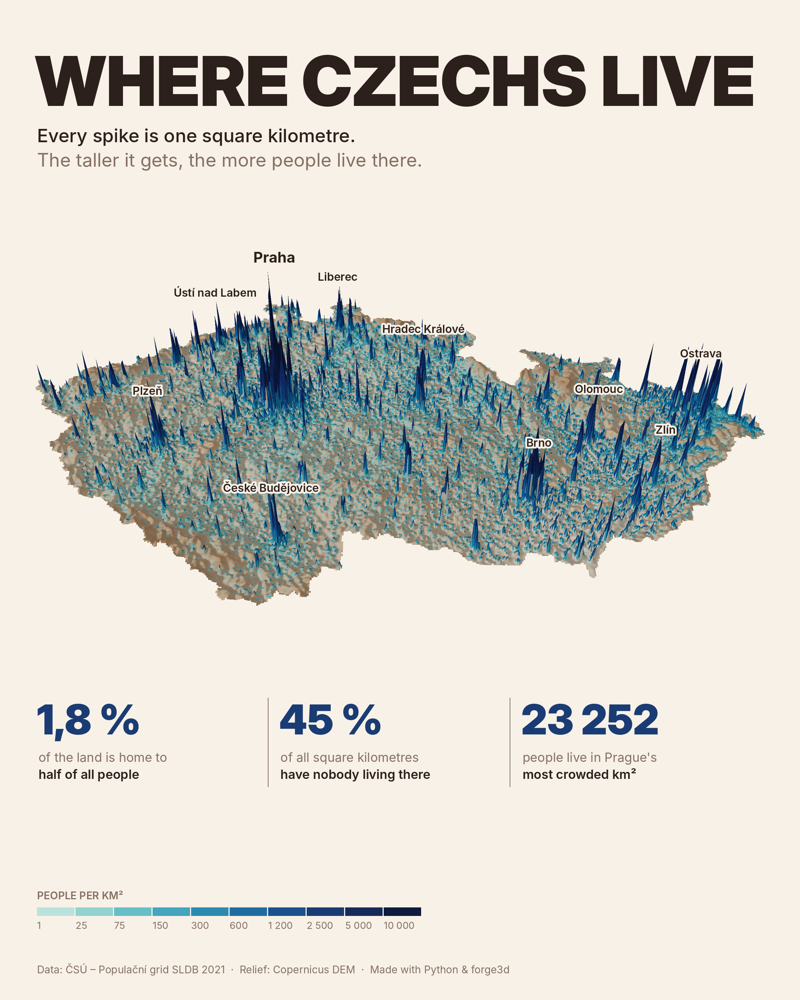
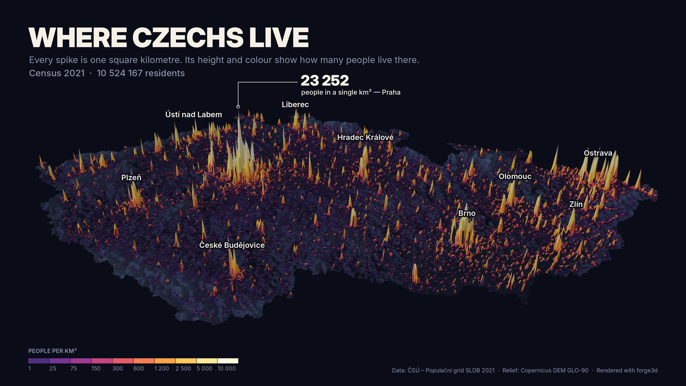
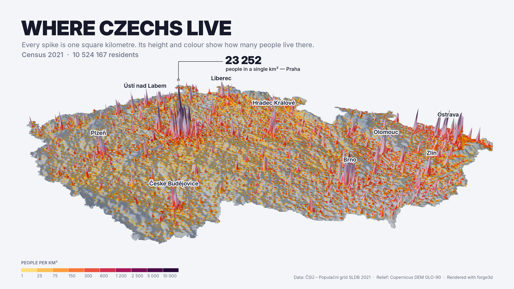
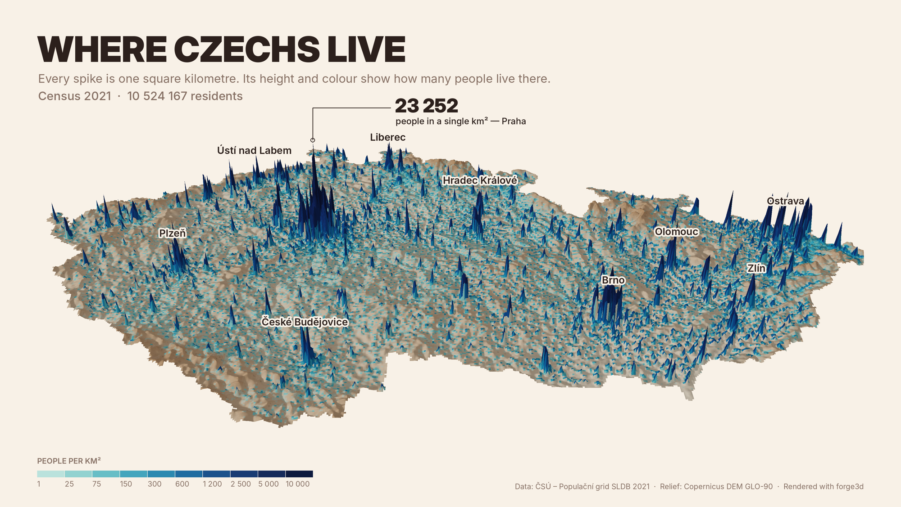
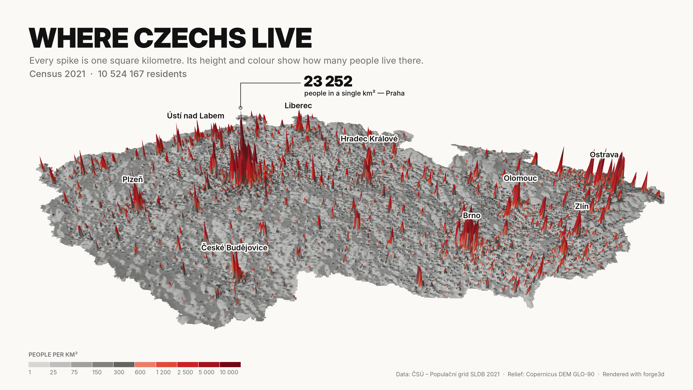
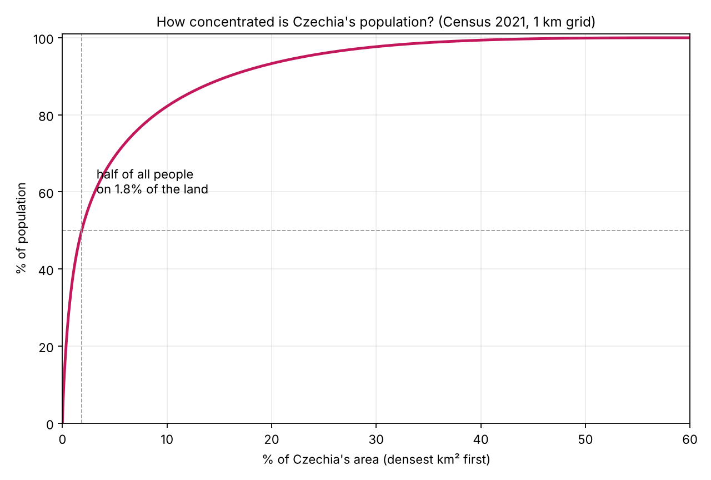

# Where Czechs live: 3D population spike maps of Czechia

Every spike is one square kilometre; its height and colour show how many people live there.
Data: ČSÚ 1 km population grid from Census 2021, relief from Copernicus DEM, rendered in 3D with
[forge3d](https://github.com/milos-agathon/forge3d).

<p align="center">
  
  
</p>

| night | glacier |
|---|---|
|  |  |
| **terracotta** | **editorial** |
|  |  |

> **Česky:** 3D „spike“ mapa obyvatel Česka. Každý bodec = 1 km², výška a barva = počet obyvatel.
> Data ČSÚ (populační grid ze Sčítání 2021), reliéf Copernicus DEM, render v Pythonu přes forge3d.
> Skripty níže stáhnou data, vykreslí mapu v několika barevných variantách, ověří čísla
> a umí odhadnout grid k 1. 1. 2025 z aktuálních počtů obyvatel obcí.

## What's in the numbers

| claim | value | how it is checked |
|---|---|---|
| half of all people live on … of the land | **1.8 %** (1 452 km²) | densest km² first, until 50 % of 10 524 167 people |
| square kilometres with nobody living there | **45 %** (36 334 of 80 139) | 44.6 % if only cells centred inside Czechia |
| people in Prague's most crowded km² | **23 252** | cell `1kmN3006E4639`, Žižkov area |

The 1.8 % depends on the unit you measure in: with 2 km squares it is 3.0 %, with 5 km 6.6 %,
with 10 km 11 %, and by whole municipalities 7 %. `scripts/validate_facts.py` prints all of these and
cross-checks the grid against the municipal register (r = 0.9998 over 6 258 municipalities) and
Prague's boundary; see [`validation/validation_report.txt`](validation/validation_report.txt).



## Run it

```bash
pip install -r requirements.txt
bash scripts/download_data.sh            # ~300 MB into ./data
```

forge3d renders on the GPU (Vulkan / Metal / DX12). On a headless Linux box without a GPU,
software Vulkan works too (slower, about a minute per image):

```bash
sudo apt install mesa-vulkan-drivers
export WGPU_BACKENDS=vulkan VK_ICD_FILENAMES=/usr/share/vulkan/icd.d/lvp_icd.json
```

**3D map, landscape** (themes: `night`, `glacier`, `terracotta`, `editorial`)

```bash
python scripts/czechia_spikes_forge3d.py data/grid_obyvatelstvo_sldb2021_20210326.gpkg out/night.png \
  --dem data/dem --theme night
```

**3D map, 4:5 portrait for LinkedIn / Instagram** (title, map, three stat tiles, legend)

```bash
python scripts/czechia_spikes_forge3d.py data/grid_obyvatelstvo_sldb2021_20210326.gpkg out/linkedin.png \
  --dem data/dem --theme night --layout linkedin \
  --size 3000 2000 --theta 49 --spike-km 110 --radius 5700 --target 0 150 0
```

The camera is fitted automatically so the whole country (including the tallest spikes) stays in
frame; `--no-autofit` turns that off. Other knobs: `--theta` tilt, `--phi` view direction,
`--sun-compass` / `--sun-el` light, `--spike-km` spike height; colours live in `THEMES` at the top of the script.

**Flat 2D version** (matplotlib only, no GPU)

```bash
python scripts/spike_map_cz.py data/grid_obyvatelstvo_sldb2021_20210326.gpkg data/countries.geojson out/flat.png
```

**Validate the numbers**

```bash
python scripts/validate_facts.py data/grid_obyvatelstvo_sldb2021_20210326.gpkg \
  data/lau_2021.geojson data/nuts3_2021.geojson validation/
```

**Estimate a 2025 grid**

ČSÚ publishes the 1 km grid only from the census (2021). It does publish population per
municipality every year, so `build_grid_2025.py` rescales the 2021 grid municipality by
municipality: municipal totals match ČSÚ 1 Jan 2025 exactly (10 909 500), while the pattern *inside*
each municipality stays as in 2021. Treat it as an estimate.

```bash
python scripts/build_grid_2025.py data/grid_obyvatelstvo_sldb2021_20210326.gpkg \
  data/lau_2021.geojson data/obce_2025.xlsx data/grid_2025_estimate.gpkg
python scripts/czechia_spikes_forge3d.py data/grid_2025_estimate.gpkg out/linkedin_2025.png \
  --dem data/dem --theme night --layout linkedin --size 3000 2000 --theta 49 --spike-km 110 \
  --period "1 Jan 2025 (estimate)" \
  --data-credit "Data: ČSÚ – municipal population 1 Jan 2025, spread by the Census 2021 grid"
```

## Data and credits

- **Population grid:** Český statistický úřad, [Obyvatelstvo za kilometrové gridy – Populační grid (Sčítání 2021)](https://geodata.csu.gov.cz/as/dp-gis/?sort=name&sortType=asc&tab=dj&col=dataSet&locale=cs&ft=obyvatel&idDset=c2cb74ff-d7ce-4c22-85ce-723b23d913bd)
- **Municipal population 1 Jan 2025:** ČSÚ, [Počet obyvatel v obcích](https://csu.gov.cz/produkty/pocet-obyvatel-v-obcich-rlm0s92pwn)
- **Boundaries:** © EuroGeographics for the administrative boundaries (Eurostat GISCO: countries, LAU 2021, NUTS 2021)
- **Relief:** Copernicus DEM GLO-90, © DLR e.V. 2010–2014 and © Airbus Defence and Space GmbH 2014–2018, provided under COPERNICUS by the European Union and ESA
- **Rendering:** [forge3d](https://github.com/milos-agathon/forge3d) by Milos Agathon; the pipeline follows its `population_spike_worldpop` examples
